# Buyers Choice

En portal som samlar det en bostadsköpare behöver veta om platsen innan visning och budgivning: gällande detaljplan, vad staden planerar runt omkring, miljö och risker samt närservice. Användaren söker på en adress. Om hen har en annonslänk visas den som ett kort med länk tillbaka till annonsen.

Portalen visar neutral information med källa. Den betygsätter inte bostäder eller områden.

Pilotkommun är **Göteborg**, och portalen täcker både villor och bostadsrätter. **Partille** är den andra kommunen. Där finns det som kommunen publicerar som öppna data (se [Fler kommuner](#fler-kommuner)).

## Så ser det ut

Skärmbilderna visar exempeladressen **Vildkaprifolen 5, Torslanda**, som har en fullständig rapport med annonskort. Övriga adresser i Göteborg får en grundrapport (se längst ned).

### Startsida och adressökning
Användaren söker på valfri adress i Göteborg eller klistrar in en annonslänk.

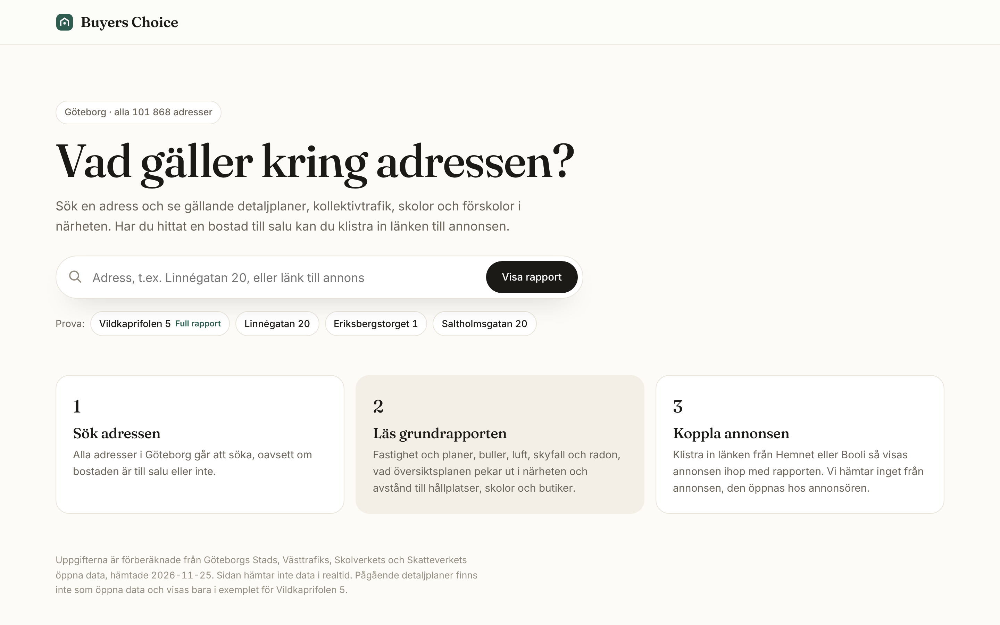

### Översikt
Annonskort, tre korta sammanfattningar (gällande plan, planerat i närheten, närmaste plan) och service i närheten.

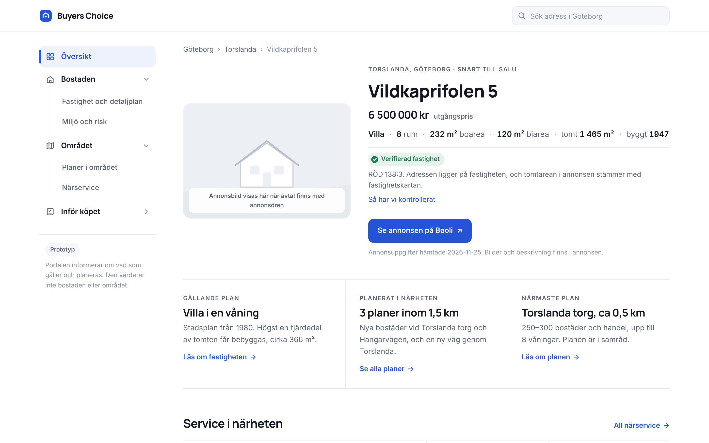

### Karta över planerna
Bostaden, planer i området, kollektivtrafik, skolor och butiker. Listan till höger flyger kartan till vald plan.

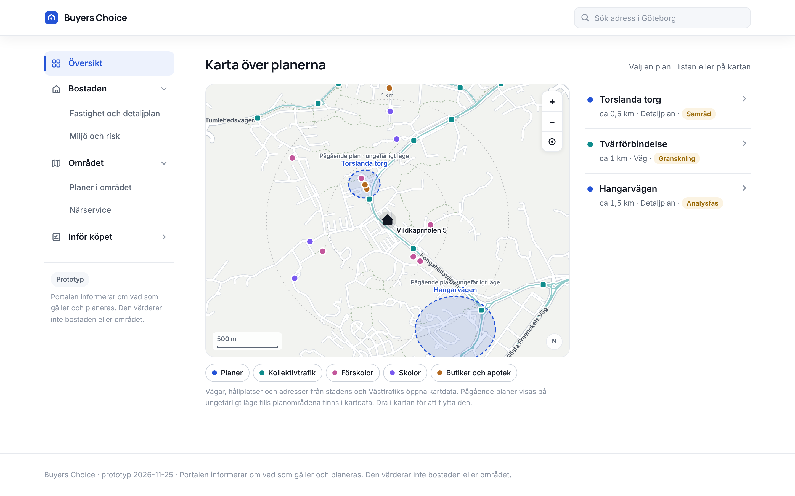

### Bostaden: Fastighet och detaljplan
Gällande plan med användning, byggrätt, höjd och genomförandetid, kontroll av fastighet och tomtarea, samt planbestämmelser.

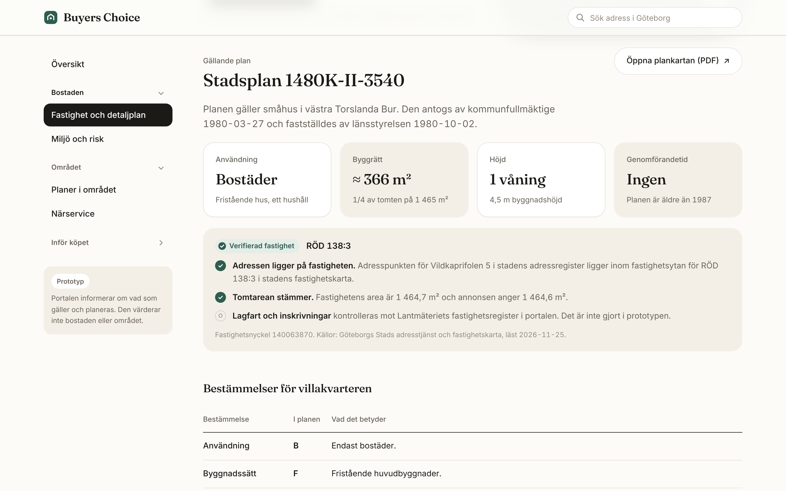

### Bostaden: Miljö och risk
Trafikbuller, flygbuller, luftkvalitet, skyfall, översvämning, radon, och förorenad mark, med riktvärden som jämförelse.

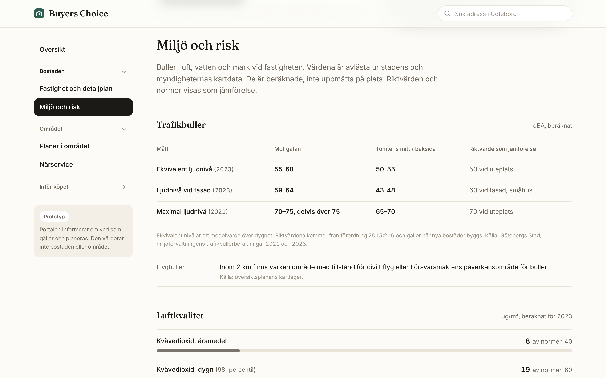

### Området: Planer i området
Tidslinje över planer och projekt inom cirka 1,5 km, och vad varje plan innebär.

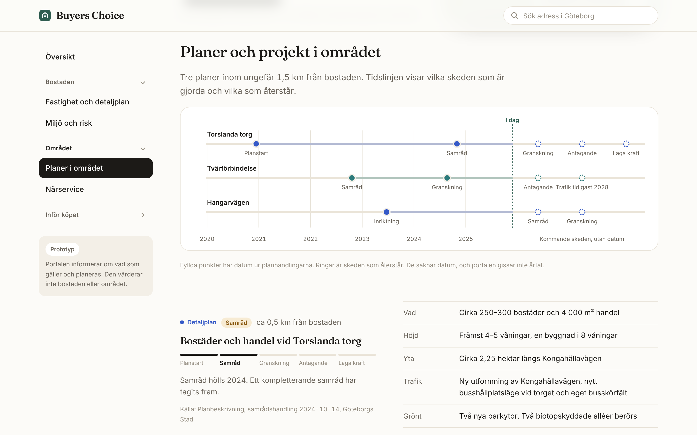

### Området: Närservice
Avstånd till hållplatser, grundskolor, förskolor och butiker.

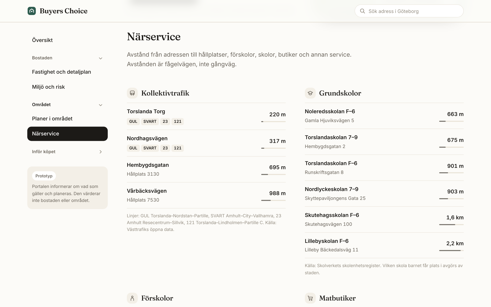

### Inför köpet: Frågor till visningen
En checklista att ta med till visningen, utifrån planerna och huset.

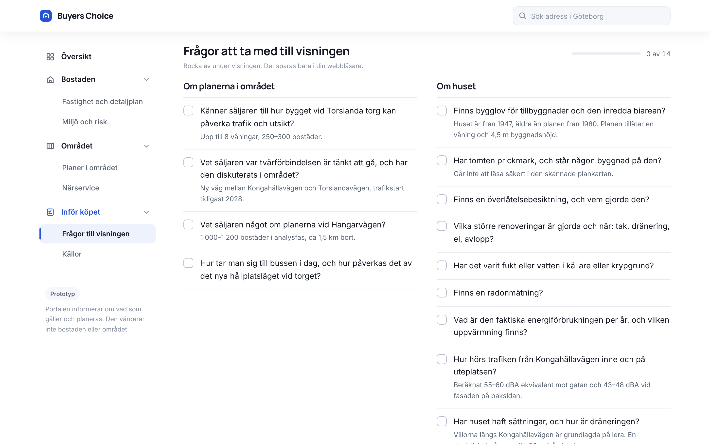

### Inför köpet: Källor
Varje uppgift med källa och datum.

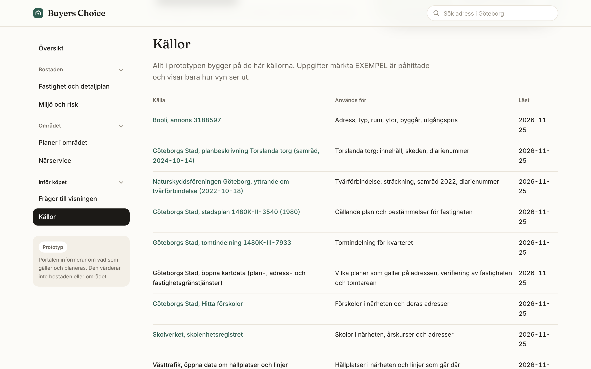

### Grundrapport för andra adresser
Alla andra adresser i Göteborg får en grundrapport ur den förberäknade datan, här Kungsportsavenyen 10. Annonslänk kan kopplas i rutan överst.

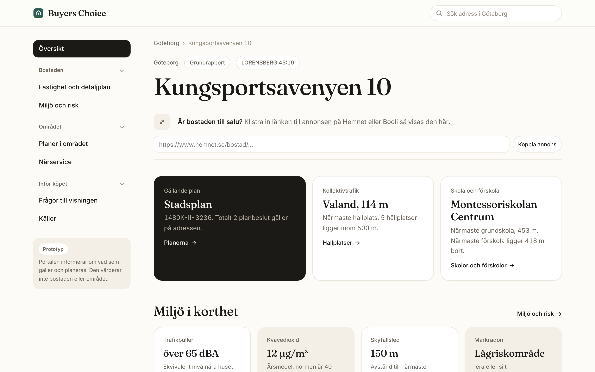

### Mobil
På mobil ersätts sidomenyn av en meny i sidhuvudet.

<p>
  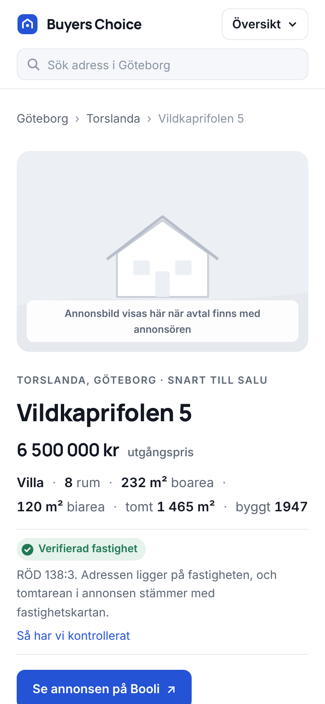
  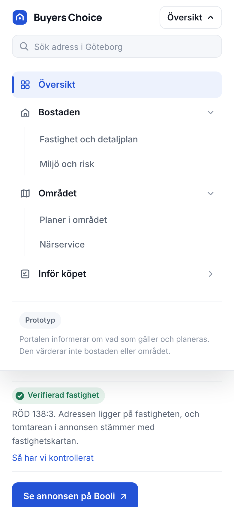
</p>

### Partille
Adresser i Partille får en grundrapport med gällande detaljplan (plankarta och planbeskrivning), fastighet, geotekniska utredningar, kommunens samhällsbyggnadsprojekt och skolor och förskolor, även på Göteborgssidan av gränsen. Det som kommunen inte publicerar, som buller och hållplatser, visas som saknat i stället för att fyllas i.

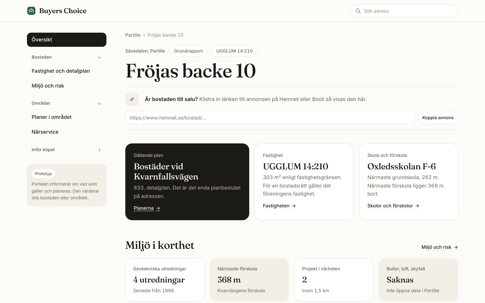

Skärmbilderna tas med `node scripts/screenshots.js` medan portalen körs lokalt (se nedan).

## Kom igång

Prototypen är en statisk webbsida utan byggsteg. Den läser JSON-filer med relativa sökvägar, så den behöver serveras över HTTP (inte öppnas direkt som fil):

```bash
cd portal
python3 -m http.server 8000
# öppna http://localhost:8000
```

### Publicering

Portalen publiceras på GitHub Pages: https://n00rp.github.io/buyers-choice/

Arbetsflödet `.github/workflows/pages.yml` lägger ut mappen `portal/` varje gång något i den ändras på `main`. Det kan också startas för hand under fliken Actions ("Publicera portalen" → "Run workflow"). Första gången måste Pages slås på i repots inställningar: Settings → Pages → Source: "GitHub Actions".

## Innehåll

| Sökväg | Vad |
| --- | --- |
| `portal/index.html` | Själva portalen: adressök, adresskort, detaljplan, framtida planer, miljö och risk, närservice. |
| `portal/adresser.json` | Alla cirka 102 000 adresspunkter i Göteborg, grupperade per gata, med index till plan- och miljödata. |
| `portal/planer.json` | Cirka 7 500 gällande planer (detaljplan, stadsplan, byggnadsplan, tomtindelning m.fl.) med beteckning, typ, namn och länk till planhandlingen (PDF). |
| `portal/framtid.json` | Utpekade förändringar i översiktsplanen (ny bebyggelse, vägar, kollektivtrafik, älvförbindelser m.m.). |
| `portal/m/*.json` | Miljö- och riskvärden per adress, uppdelat i block om 5 000 adresser. Kolumnerna beskrivs i `portal/miljo-meta.json`. |
| `portal/r/*.json` | Vägnät i rutor om 2,5 × 2,5 km, för kartritning. Beskrivs i `portal/roads-meta.json`. |
| `portal/service.json` | Hållplatser, skolor, förskolor, livsmedelsbutiker m.m. med koordinater. |
| `portal/k/<kommun>/` | Samma filer för övriga kommuner (nu `partille`). Vilka kommuner som finns och vilka uppgifter de har står i `KOM` i `index.html`. |
| `data/vildkaprifolen-5-detaljplan.json` | Manuellt tolkade planbestämmelser för exempeladressen Vildkaprifolen 5, Torslanda. |
| `scripts/` | Python-skripten som bygger JSON-filerna ovan ur stadens rådata, och `screenshots.js` som tar skärmbilderna. |
| `docs/screenshots/` | Skärmbilder av portalens olika delar. |
| `docs/datakallor.md` | Kartläggningen av datakällor: vad som finns, villkor, kostnad och juridik. |
| `arkiv/vildkaprifolen-5.html` | Den första prototypen, en sida för en enda adress. |

Koordinater är SWEREF 99 12 00 (EPSG:3007). I `adresser.json` lagras de som heltal relativt origo i fältet `o`.

## Datan är förberäknad

Portalen anropar inga kart- eller datatjänster när den körs. All data hämtades från öppna tjänster den **25 november 2026** och räknades fram i förväg: varje adresspunkt har slagits ihop med planen den ligger inom, bullervärden, luftkvalitet, radon, avstånd till skyfallsled, översvämningsområde, förorenad mark, flygbuller och farligt gods, samt fastighetsbeteckning och fastighetsarea.

Det betyder att:

- sidan laddar snabbt och fungerar utan nycklar eller inloggning,
- datan blir inaktuell med tiden och behöver byggas om för att spegla nya planbeslut,
- värdena är avlästa ur myndigheternas kartdata för punkten, inte mätningar på plats.

## Datakällor

Allt kommer från öppna tjänster utan nyckel. Fullständig kartläggning med villkor finns i [docs/datakallor.md](docs/datakallor.md).

| Data | Källa |
| --- | --- |
| Adresser | Göteborgs Stad, adress-WFS (`opengeodata.goteborg.se/services/adresser/wfs/v1`), CC0 |
| Gällande planer och planhandlingar | Stadsbyggnadskontoret, `geodata-external.sbk.goteborg.se/services/planer-v3` och `/dokument/` |
| Fastighetsgränser och beteckningar | Stadsbyggnadskontoret, `sbf-extern-fastighetsgrans-v1` (WMS GetFeatureInfo) |
| Översiktsplan, framtida förändringar, skyfall, översvämning, radon, förorenad mark | Göteborgs Stad, översiktsplan (`services.sbk.goteborg.se/oversiktsplan-v4`) |
| Vägtrafikbuller, luft (NO₂, PM10) | Miljöförvaltningen, `geoserverextern.miljoforvaltningen.goteborg.se` |
| Hållplatser | Trafikkontoret, `open.geodata.tkgbg.se/wfs` |
| Skolor | Skolverkets skolenhetsregister (`api.skolverket.se/skolenhetsregistret/v2`) |
| Förskolor | Göteborgs Stad, Hitta förskolor |

## Fler kommuner

Göteborg ligger först i listan så att gamla adresslänkar fungerar. Varje ny kommun får en mapp under `portal/k/` med samma filformat och en rad i `KOM` i `index.html`, där `har` anger vilka uppgifter kommunen har öppna data för. Det som saknas visas som saknat.

| Kommun | Läge | Källa |
| --- | --- | --- |
| Göteborg | Klar | Se tabellen ovan |
| Partille | Klar, hämtad 2026-11-27 | Partille kommuns öppna ArcGIS-tjänster (`geodata.partille.se/arcgis/rest/services`): adresser, gällande detaljplaner, fastighetsgränser, förskolor, geotekniska utredningar och samhällsbyggnadsprojekt. Skolor från Skolverket. |
| Mölndal | Väntar på datakälla | Kommunen har en webbkarta (Spatial Suite) men ingen öppen WMS/WFS eller nedladdning för adresser och planer. |
| Kungälv | Väntar på datakälla | Samma läge som Mölndal. |
| Stockholm, Malmö | Inte påbörjad | |

Partille saknar öppna data för buller, luft, skyfall, översvämning, radon, hållplatser och butiker. Hållplatser för hela Västtrafik finns hos Trafiklab men kräver en gratis API-nyckel. Lantmäteriets öppna data (adresser och fastigheter för hela landet) kräver också ett gratis konto. Båda skulle göra det betydligt lättare att lägga till fler kommuner.

Partilles data byggs med `python3 scripts/kommun_partille.py hamta` och sedan `python3 scripts/kommun_partille.py bygg`.

Inga annonser hämtas eller lagras. Portalen skrapar inte Hemnet eller Booli, och annonsbilder visas inte.

## Bygga om datan

Skripten i `scripts/` är de som användes för att ta fram den nuvarande datan. De är skrivna för en engångskörning och förväntar sig att rådata redan är nedladdad som GeoJSON under `/tmp/geo/` (adresser, planer, miljölager). Själva nedladdningen från WFS-tjänsterna gjordes för hand och finns inte som skript ännu.

| Skript | Gör |
| --- | --- |
| `build.py` | Kopplar adresser till planer och skriver `adresser.json`, `planer.json` och `service.json`. |
| `build_env.py` | Räknar fram miljö- och riskvärden per adress och skriver `framtid.json`. |
| `noise2.py` | Bullervärden per adress (fasad och lägsta nivå). |
| `fast.py` | Hämtar fastighetsbeteckning och area per adress via fastighets-WMS. |
| `fut_extra.py` | Kompletterar `framtid.json` med länkar ur översiktsplanen. |
| `build_roads.py` | Delar upp vägnätet i rutor (`r/`). |
| `shards.py` | Delar upp miljödatan i block (`m/`) och skriver `miljo-meta.json`. |

Beroenden: Python 3, `numpy`, `shapely`, `pyproj`, `tifffile`.

Ett naturligt nästa steg är ett hämtningsskript som laddar ned rådata från tjänsterna ovan, så att hela kedjan kan köras om med ett kommando.

## Status

Detta är en prototyp. Planbestämmelser är bara tolkade manuellt för exempeladressen. Pågående planarbete, bygglov och bostadsrättsföreningars årsredovisningar finns inte maskinläsbart och ingår inte ännu.
